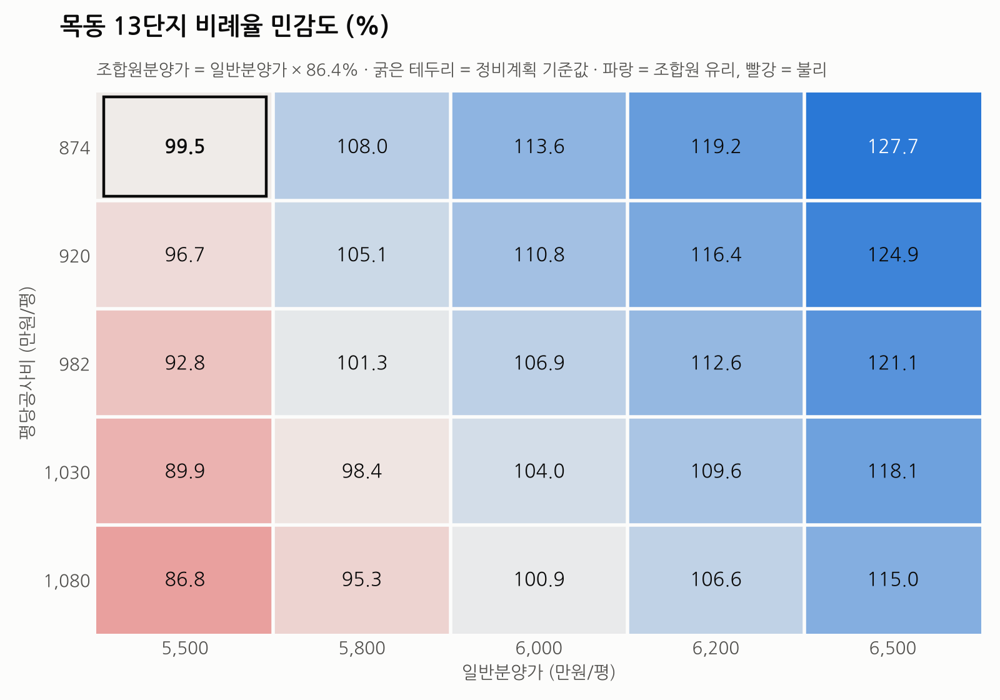
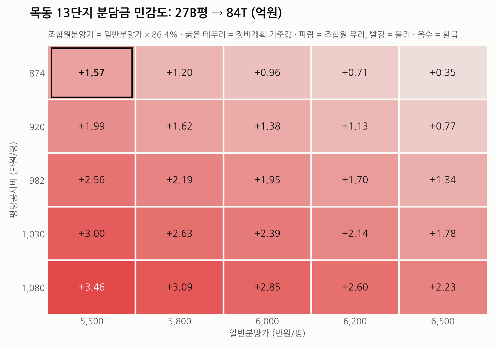

# [사업성분석#21] 목동 13단지 재건축 분담금, 분양가, 비례율, 공사비&분양가 민감도

## 1) 목동 13단지 아파트 기본정보

**목동 13단지아파트** · 서울특별시 양천구 목동동로 100

- 준공일 : 1987. 7. 30. (40년차)
- 세대수 : 2,280세대
- 용적률 : 159 %
- 평형대 : 21 ~ 58평형(공급평형)

> ✍️ [작성] 이 단지를 고른 이유, 최근 이슈(시공사 선정·심의 등)

## 2) 대지지분, 시세

- 대지면적 : 162,139.7㎡ (49,047.3평)

타입별 전용면적, 공급면적, 세대수, 대지지분, 현재시세 표

| 타 입 | 전용면적 | 공급면적 | 세대수 | 대지지분(평) | 추정시세(천원) |
|---|---|---|---|---|---|
| 21평 | 53.90 ㎡ | 72.37 ㎡ | 240 | 12.2 평 | 1,150,000 |
| 27B평 | 70.73 ㎡ | 92.43 ㎡ | 780 | 16.0 평 | 1,490,000 |
| 31평 | 84.41 ㎡ | 105.24 ㎡ | 24 | 19.1 평 | 1,660,000 |
| 37B평 | 99.26 ㎡ | 123.76 ㎡ | 96 | 22.5 평 | 1,850,000 |
| 38A평 | 98.63 ㎡ | 128.89 ㎡ | 600 | 22.4 평 | 1,850,000 |
| 39평 | 103.97 ㎡ | 131.14 ㎡ | 14 | 23.6 평 | 1,880,000 |
| 45C평 | 122.30 ㎡ | 149.47 ㎡ | 196 | 27.7 평 | 2,050,000 |
| 46B평 | 122.30 ㎡ | 152.49 ㎡ | 16 | 27.7 평 | 2,050,000 |
| 46평 | 124.55 ㎡ | 155.30 ㎡ | 64 | 28.2 평 | 2,050,000 |
| 56C평 | 151.76 ㎡ | 185.48 ㎡ | 210 | 34.4 평 | 2,420,000 |
| 57B평 | 154.37 ㎡ | 191.15 ㎡ | 8 | 35.0 평 | 2,420,000 |
| 58A평 | 156.62 ㎡ | 193.93 ㎡ | 32 | 35.5 평 | 2,420,000 |
| 상가 등 | - | - | - | 902.0 평 | 83,131,000 |
| 합 계 | 212,308.98 ㎡ | 271,401.80 ㎡ | 2,280 | 49,016.0 평 | 4,045,891,000 |

토지등소유자 수 : 2,353명 (정비몽땅 게시 기준)

총 종전자산가액은 주택 3조 9,628억원, 상가 831억원 수준으로 나온다.

## 3) 재건축 예상 계획

서울특별시고시 제2025-122호에 따라 목동 13단지의 정비구역 지정이 고시되었다.

> ✍️ [작성] 고시문 PDF 첨부, 조감도·결정도 이미지 삽입

- 계획 용적률 : 획지1 - 299.94%, 획지2 - 299.98%

[공동주택 계획]

| 타 입 | 전용면적 | 공급면적 | 세대수 | 대지지분(평) | 구성 |
|---|---|---|---|---|---|
| 59T | 59.99 ㎡ | 82.18 ㎡ | 854 | 8.1 평 | 일반 365 / 공공 444 / 기부채납 45 |
| 74T | 74.20 ㎡ | 100.27 ㎡ | 362 | 10.1 평 | 일반 297 / 공공 43 / 기부채납 22 |
| 84T | 84.99 ㎡ | 114.08 ㎡ | 1,474 | 11.5 평 | 조합원 1,118 / 일반 342 / 기부채납 14 |
| 101T | 101.90 ㎡ | 134.08 ㎡ | 410 | 13.8 평 | 조합원 410 |
| 108T | 108.90 ㎡ | 143.67 ㎡ | 172 | 14.8 평 | 조합원 172 |
| 132T | 132.00 ㎡ | 173.68 ㎡ | 306 | 17.9 평 | 조합원 306 |
| 162T | 162.00 ㎡ | 210.39 ㎡ | 262 | 22.0 평 | 조합원 262 |
| 182T | 182.00 ㎡ | 233.33 ㎡ | 12 | 24.7 평 | 조합원 12 |
| 합 계 | 348,896.92 ㎡ | 465,385.64 ㎡ | 3,852 | - | 조합원 2,280 / 일반 1,004 / 공공 487 / 기부채납 81 |

## 4) 사업성 분석 (기존 정비구역 결정고시 추정치)

[사업비, 비례율 분석]

- 일반분양가 : 5,500만원/평
- 조합원분양가 : 4,750만원/평 (일반분양가 86%)
- 상가매각가 : 1,506억원 (상가조합원 768.8억원 + 일반분양 737.4억원)
- 평당공사비 : 874만원
- 공공주택은 기본형 건축비로 책정하여 매각
- 공사기간 : 48개월
- 총 사업비 : 2조 4,689억원

| 사업비 구분 | 사업비(천원) | 수입 구분 | 수입(천원) |
|---|---|---|---|
| 공사비(철거 포함) | 2,115,114,261 | 조합원분양 | 4,573,480,676 |
| 설계+감리+관리 | 58,949,580 | 일반분양 | 1,703,310,704 |
| 수수료 및 기타사업비 | 118,344,263 | 상가분양 | 150,627,100 |
| 각종 부(분)담금 | 20,561,160 | 공공주택 | 68,178,100 |
| 금융비 | 41,049,700 | 매출부가세 | -1,474,906 |
| 법인세 | 1,100,000 |  |  |
| 기타경비 | 8,012,000 |  |  |
| 예비비 | 105,755,710 |  |  |
| 사업비 합계 | 2,468,886,674 | 총수입 합계 | 6,494,121,674 |

비례율 계산

| 구 분 | 금 액(천원) |
|---|---|
| 총 수입합계 | 6,494,121,674 |
| 종전감정평가액 | 4,045,891,000 |
| 총사업비 | 2,468,886,674 |
| 비례율 | 99.49% |

[평형별 추정 분담금표] (단위: 억원, 음수 = 환급)

| 종전 \ 신축 | 권리가액 | 59T | 74T | 84T | 101T | 108T | 132T | 162T | 182T |
|---|---|---|---|---|---|---|---|---|---|
| 21평 | 11.44 | 1.08 | 3.83 | 4.95 | 7.82 | 9.20 | 13.51 | 18.79 | 22.09 |
| 27B평 | 14.82 | -2.31 | 0.45 | 1.57 | 4.44 | 5.82 | 10.13 | 15.41 | 18.70 |
| 31평 | 16.52 | -4.00 | -1.24 | -0.12 | 2.75 | 4.13 | 8.44 | 13.72 | 17.01 |
| 37B평 | 18.41 | -5.89 | -3.13 | -2.01 | 0.86 | 2.24 | 6.55 | 11.82 | 15.12 |
| 38A평 | 18.41 | -5.89 | -3.13 | -2.01 | 0.86 | 2.24 | 6.55 | 11.82 | 15.12 |
| 39평 | 18.70 | -6.19 | -3.43 | -2.31 | 0.56 | 1.94 | 6.25 | 11.53 | 14.82 |
| 45C평 | 20.40 | -7.88 | -5.12 | -4.00 | -1.13 | 0.25 | 4.56 | 9.84 | 13.13 |
| 46B평 | 20.40 | -7.88 | -5.12 | -4.00 | -1.13 | 0.25 | 4.56 | 9.84 | 13.13 |
| 46평 | 20.40 | -7.88 | -5.12 | -4.00 | -1.13 | 0.25 | 4.56 | 9.84 | 13.13 |
| 56C평 | 24.08 | -11.56 | -8.80 | -7.68 | -4.81 | -3.43 | 0.88 | 6.15 | 9.45 |
| 57B평 | 24.08 | -11.56 | -8.80 | -7.68 | -4.81 | -3.43 | 0.88 | 6.15 | 9.45 |
| 58A평 | 24.08 | -11.56 | -8.80 | -7.68 | -4.81 | -3.43 | 0.88 | 6.15 | 9.45 |
| 조합원분양가 |  | 12.52 | 15.27 | 16.39 | 19.27 | 20.64 | 24.96 | 30.23 | 33.53 |

분담금 범위는 최대 11.6억원 환급 ~ 최대 22.1억원 부담 구간이다.

> ✍️ [작성] 분담금표 해석 (환급 구간, 1+1 가능성 등)

## 5) 삼성물산(래미안 모브13) 선정에 따른 사업성 변화

[총 사업비 변동사항]

| 구 분 | 변경 전(천원) | 변경 후(천원) | 비 고 |
|---|---|---|---|
| 공사비(철거 포함) | 2,115,114,261 | 2,376,309,092 | +12.3% |
| 설계+감리+관리 | 58,949,580 | 58,949,580 | 변경없음 |
| 수수료 및 기타사업비 | 118,344,263 | 118,344,263 | 변경없음 |
| 각종 부(분)담금 | 20,561,160 | 20,561,160 | 변경없음 |
| 금융비 | 41,049,700 | 45,155,764 | +10.0% |
| 법인세 | 1,100,000 | 1,100,000 | 변경없음 |
| 기타경비 | 8,012,000 | 8,252,424 | +3.0% |
| 예비비 | 105,755,710 | 108,929,227 | +3.0% |
| 사업비 합계 | 2,468,886,674 | 2,737,601,510 | +10.9% |

- 공사비 : 평당 874만원 → 평당 982만원

[분양가 변동사항]

> ✍️ [작성] 주변 신축 실거래가 근거 (단지명, 실거래가, 평단가)

| 구 분 | 변경 전(천원) | 변경 후(천원) | 비 고 |
|---|---|---|---|
| 조합원분양 | 4,573,480,676 | 4,766,339,142 | +4.2% |
| 일반분양 | 1,703,310,704 | 1,796,218,561 | +5.5% |
| 상가분양 | 150,627,100 | 150,627,100 | 변경없음 |
| 공공주택 | 68,178,100 | 73,014,839 | +7.1% |
| 매출부가세 | -1,474,906 | -1,474,906 | 변경없음 |
| 총수입 합계 | 6,494,121,674 | 6,784,724,736 | +4.5% |

[변경 비례율 및 추정 분담금표]

| 구 분 | 금 액(천원) |
|---|---|
| 총 수입합계 | 6,784,724,736 |
| 종전감정평가액 | 4,045,891,000 |
| 총사업비 | 2,737,601,510 |
| 비례율 | 100.03% |

비례율은 99.49% → 100.03%로 +0.54%p 변한다.

| 종전 \ 신축 | 권리가액 | 59T | 74T | 84T | 101T | 108T | 132T | 162T | 182T |
|---|---|---|---|---|---|---|---|---|---|
| 21평 | 11.50 | 1.54 | 4.41 | 5.58 | 8.57 | 10.01 | 14.50 | 20.00 | 23.44 |
| 27B평 | 14.90 | -1.86 | 1.01 | 2.18 | 5.17 | 6.61 | 11.10 | 16.60 | 20.04 |
| 31평 | 16.61 | -3.56 | -0.69 | 0.48 | 3.47 | 4.91 | 9.40 | 14.90 | 18.34 |
| 37B평 | 18.51 | -5.46 | -2.59 | -1.42 | 1.57 | 3.01 | 7.50 | 13.00 | 16.43 |
| 38A평 | 18.51 | -5.46 | -2.59 | -1.42 | 1.57 | 3.01 | 7.50 | 13.00 | 16.43 |
| 39평 | 18.81 | -5.76 | -2.89 | -1.72 | 1.27 | 2.71 | 7.20 | 12.70 | 16.13 |
| 45C평 | 20.51 | -7.46 | -4.59 | -3.42 | -0.43 | 1.01 | 5.50 | 11.00 | 14.43 |
| 46B평 | 20.51 | -7.46 | -4.59 | -3.42 | -0.43 | 1.01 | 5.50 | 11.00 | 14.43 |
| 46평 | 20.51 | -7.46 | -4.59 | -3.42 | -0.43 | 1.01 | 5.50 | 11.00 | 14.43 |
| 56C평 | 24.21 | -11.16 | -8.29 | -7.12 | -4.13 | -2.69 | 1.80 | 7.30 | 10.73 |
| 57B평 | 24.21 | -11.16 | -8.29 | -7.12 | -4.13 | -2.69 | 1.80 | 7.30 | 10.73 |
| 58A평 | 24.21 | -11.16 | -8.29 | -7.12 | -4.13 | -2.69 | 1.80 | 7.30 | 10.73 |
| 조합원분양가 |  | 13.04 | 15.92 | 17.08 | 20.08 | 21.51 | 26.01 | 31.51 | 34.94 |

## 6) 공사비 & 분양가 민감도

평당공사비(874만원, 920만원, 982만원, 1,030만원, 1,080만원)와 일반분양가(5,500만원, 5,800만원, 6,000만원, 6,200만원, 6,500만원)를 바꿔가며 비례율과 분담금을 계산했다.

- 비례율 범위 : 86.8% ~ 127.7%
- 27B평 → 84T 분담금 범위 : +0.35억원 ~ +3.46억원

> ✍️ [작성] 민감도 해석 (분양가 100만원 상승 vs 공사비 100만원 상승 효과 비교 등)

## 7) 마무리

> ✍️ [작성] 향후 일정, 모니터링 포인트, 리스크 요인

*개인적으로 분석해 본 내용으로서, 여러 가정 요인들이 많기에 참고용으로만 봐주시길 바라며, 혹 틀린부분이나 보완할 부분에 대해 댓글 등으로 의견 주시면 감사드리겠습니다.
